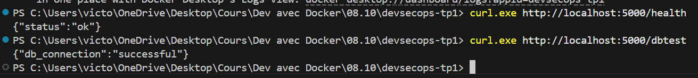
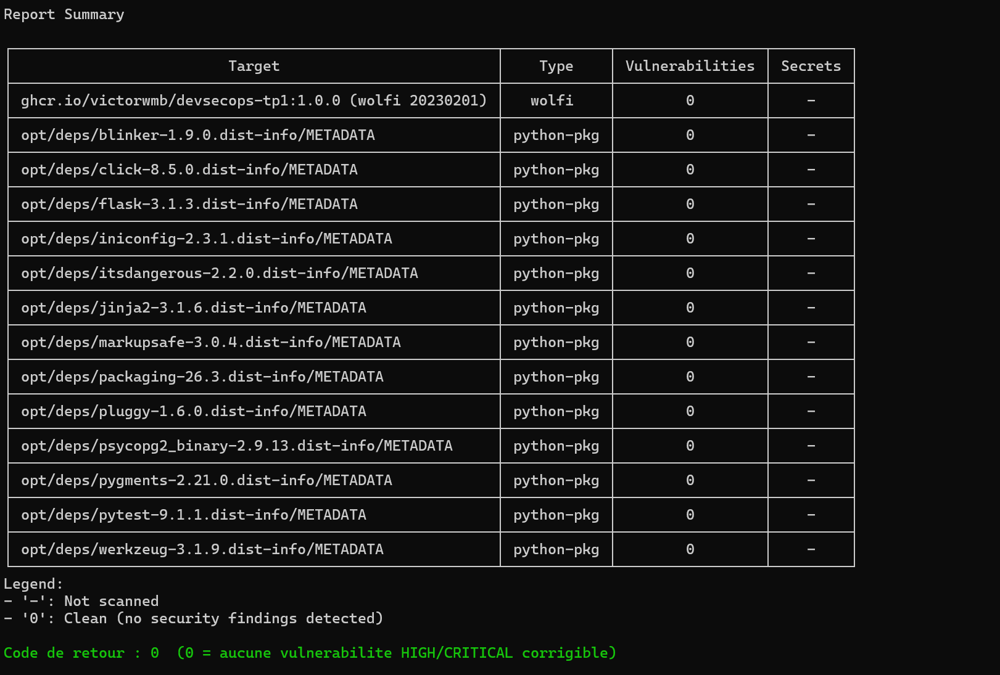
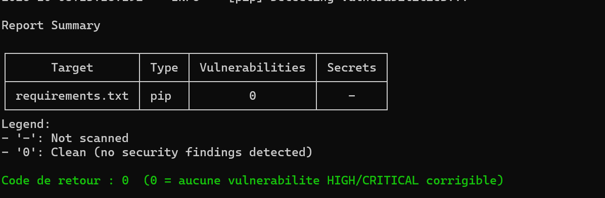
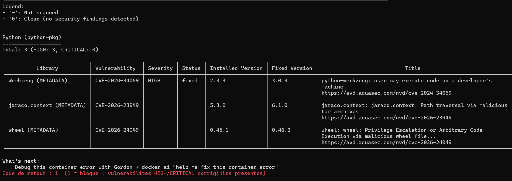

# Hardening Flask & PostgreSQL

Binôme : **Victor** & **Kylian**

Architecture : une API Flask (`api-python`) et une base PostgreSQL (`db`).

- La base n'est reliée qu'au réseau `backend` (`internal: true`, sans route vers l'extérieur) et ne publie aucun port.
- L'API est reliée à `backend` et à `frontend` (port 5000, publié uniquement sur `127.0.0.1`).
- Le mot de passe de la base est un secret Docker monté dans `/run/secrets` : il n'apparaît ni dans le Compose, ni dans les variables d'environnement.
- Le pipeline GitHub Actions valide le code, l'image et la composition, puis publie l'image sur GHCR.

**Organisation du binôme** : nous avons travaillé en pair programming, à deux sur le même poste (d'où les commits depuis le compte de Victor). L'un tapait pendant que l'autre relisait et proposait des idées, et nous échangions régulièrement les rôles. Nous avons commencé par lire le sujet et les cours ensemble, puis nous avons réfléchi à deux à chaque choix avant de le mettre en place. À chaque étape, nous avons testé ensemble que tout fonctionnait.

## 1. Liens GHCR

- Package : https://github.com/victorwmb/devsecops-tp1/pkgs/container/devsecops-tp1
- Dernière version : `docker pull ghcr.io/victorwmb/devsecops-tp1:2.0.0`
- Version initiale : `docker pull ghcr.io/victorwmb/devsecops-tp1:1.0.0`

## 2. Avant / Après

| | API avant | API après | BDD avant | BDD après |
|---|---|---|---|---|
| Image | python:3.10-slim | Chainguard Python 3.15 | postgres:14-alpine | Chainguard Postgres 18.6 |
| Poids | 167,9 Mo | 100,4 Mo | 299,2 Mo | 378,8 Mo |
| Utilisateur | root | nonroot (uid 65532) | root, puis postgres (entrypoint) | postgres (uid 70) dès le démarrage |
| Shell | oui | non | oui | oui (entrypoint) |
| Mot de passe | en clair (Compose + env) | secret `/run/secrets` | en clair (Compose + env) | secret `/run/secrets` |
| Système de fichiers | inscriptible | lecture seule | inscriptible | lecture seule |
| Capacités Linux | jeu par défaut | aucune | jeu par défaut | aucune |
| CVE (Trivy) | 185 | 0 | 47 | 0 |
| Dive | 97,35 % | 99,73 % | 99,89 % | 99,85 % |

Les valeurs « après » ont été remesurées le 26/10 après la mise à jour des digests (section 6).

## 3. Images de base

- **Chainguard plutôt que Distroless** : Chainguard (base Wolfi) est mise à jour plus vite que Distroless (base Debian) et vise 0 CVE. Elle est la même famille que l'image Postgres imposée.
- **Variante de build** : `latest-dev` (avec pip) a le même Python que `latest` (sans shell ni pip). Les dépendances installées dans le builder fonctionnent donc directement dans l'image finale.
- **Immuabilité** : toutes les images sont épinglées par digest SHA256 et les dépendances Python par version exacte (`==`).

## 4. Healthchecks sans shell

`CMD-SHELL` a besoin de `/bin/sh`, absent de l'image. Les deux sondes utilisent donc la forme exec `["CMD", ...]` :

- **API** : `python -c "urllib.request.urlopen('http://127.0.0.1:5000/health')"`. Elle utilise le Python de l'image et sa bibliothèque standard, sans curl.
- **BDD** : `pg_isready -h 127.0.0.1 -U testuser -d testdb`. L'option `-h` force le TCP, pour que la base ne soit déclarée saine qu'une fois réellement prête.
- **Ordre de démarrage** : `depends_on: condition: service_healthy` fait attendre l'API jusqu'à ce que la base soit saine.

## 5. Secrets et durcissement de l'orchestration

### Secrets

**Avant** : `DB_PASSWORD=testpass` et `POSTGRES_PASSWORD: testpass` étaient écrits en clair dans `docker-compose.yml`, un fichier versionné. Le mot de passe était aussi visible avec `docker inspect` et dans `/proc/1/environ`, et hérité par tous les processus enfants. `app.py` contenait en plus une valeur par défaut codée en dur.

**Après** : le mot de passe est un **secret Docker** (`secrets.db_password`). Il est lu depuis `secrets/db_password.txt`, fichier exclu par `.gitignore` et `.dockerignore`, puis monté en lecture seule dans `/run/secrets/db_password`.

- **Postgres** lit le secret via `POSTGRES_PASSWORD_FILE` (fonction `file_env` de l'entrypoint).
- **L'API** le lit via `DB_PASSWORD_FILE`, à chaque connexion. La valeur par défaut codée en dur a été supprimée.
- **Seuls les chemins** figurent dans l'environnement : `docker inspect` ne contient plus le mot de passe.
- **En CI**, un mot de passe aléatoire de 256 bits est généré à chaque exécution (`openssl rand -hex 32`). Il est masqué dans les journaux (`::add-mask::`) et supprimé au teardown. Aucun secret statique n'existe dans le dépôt.

Lancement en local :

```bash
mkdir -p secrets
openssl rand -hex 32 | tr -d '\r\n' > secrets/db_password.txt   # tr : sous Windows, openssl ajoute un \r
docker compose up -d --build --wait
```

### Durcissement système des conteneurs

Les mesures communes sont factorisées dans une ancre YAML (`x-hardening`) :

| Mesure | API | BDD | Effet |
|---|---|---|---|
| `user` | `65532:65532` | `70:70` | aucun processus root, y compris au démarrage de la base |
| `read_only: true` | oui | oui | système de fichiers racine en lecture seule ; `tmpfs` en `noexec,nosuid,nodev` pour `/tmp` (et `/var/run/postgresql`) |
| `cap_drop: [ALL]` | oui | oui | aucune capacité Linux |
| `no-new-privileges:true` | oui | oui | aucune élévation de privilèges possible |
| Limites (`deploy.resources`) | 0,5 CPU, 256 Mo, 128 PID | 1 CPU, 512 Mo, 128 PID | un conteneur ne peut pas épuiser l'hôte (boucle, fuite mémoire, fork bomb) |
| Réseau | `frontend` + `backend`, port sur `127.0.0.1` | `backend` (`internal: true`) | base inaccessible hors de la stack, sans accès Internet |
| `restart: unless-stopped` | oui | oui | redémarrage automatique en cas de crash |
| Journaux | 3 × 10 Mo | 3 × 10 Mo | rotation, pas de saturation du disque |

**Base sans root** : l'image Chainguard Postgres démarre en root, fait des `chown` puis passe sous `postgres` avec `gosu`. C'est incompatible avec `cap_drop: [ALL]`. Nous la lançons donc directement en `70:70` :

- le volume est monté sur `/var/lib/postgresql`, qui appartient à `postgres` dans l'image, au lieu de `.../data` ;
- le volume est donc initialisé avec ce propriétaire, et l'entrypoint n'a plus besoin de `chown` ni de `gosu`.

## 6. Remédiations

**Flake8** : 11 violations corrigées (lignes vides manquantes avant les fonctions, espaces sur une ligne vide, fin de fichier) dans `app.py` et `test_app.py`.

**Dépendances** :

| Paquet | Avant | Après | Raison |
|---|---|---|---|
| Werkzeug | 2.3.3 | 3.1.9 | CVE-2024-34069 (HIGH) + 7 MEDIUM |
| Flask | 2.3.2 | 3.1.3 | CVE-2026-27205 |
| pytest | 7.4.0 | 9.1.1 | CVE-2025-71176 |
| psycopg2-binary | non épinglé | 2.9.13 | version fixe et auditable |

**Images de base (26/10)** : l'image API épinglée le 08/10 faisait échouer le quality gate Trivy. 4 vulnérabilités HIGH corrigibles avaient été publiées entre-temps :

- CVE-2026-111943 dans `ca-certificates-bundle` ;
- CVE-2026-111497 dans `libbrotlicommon1`, `libbrotlidec1` et `libbrotlienc1`.

Les trois digests ont été mis à jour (`python:latest-dev`, `python:latest`, `postgres:latest`). Python passe de 3.14.8 à 3.15.0, identique dans le builder et le runtime. Résultat : 0 CVE sur les deux images, toutes sévérités confondues.

## 7. Sécurité CI/CD

- **Permissions** : `permissions: {}` au niveau du workflow. Chaque job ne reçoit que `contents: read`, et seul le job de publication obtient `packages: write`.
- **Connexion à GHCR** : via le jeton natif `GITHUB_TOKEN`.
- **Épinglage** : les actions sont épinglées par SHA de commit (un tag peut être déplacé, un SHA non), et les outils Hadolint, Dive et Trivy par digest.
- **SemVer** : la publication n'a lieu que sur un tag `vX.Y.Z`, si tous les jobs précédents ont réussi. Par exemple, `v1.2.3` publie les tags `1.2.3`, `1.2`, `1` et `latest`.
- **Version 2.0.0** : l'image ne lit plus le mot de passe dans `DB_PASSWORD` mais dans le fichier pointé par `DB_PASSWORD_FILE`. Un déploiement configuré pour la 1.x ne fonctionne donc plus tel quel : c'est un changement incompatible, d'où une version **majeure**.
- **Contrôles de la composition** (job 5, bloquants) :
  - avant le démarrage, `docker compose config` + `jq` fait échouer le job si une variable `*PASS*`, `*SECRET*` ou `*TOKEN*` autre qu'un `*_FILE` est déclarée ;
  - après le démarrage, `docker inspect` vérifie pour chaque conteneur : utilisateur non root, `ReadonlyRootfs`, `CapDrop: ALL`, `no-new-privileges` et absence de secret dans l'environnement.
- **Scan de l'image Postgres** (job 4) : le digest de `docker-compose.yml` est scanné par Trivy avec le même seuil bloquant que l'image API.

## 8. Preuves d'exécution

| Contrôle | Résultat |
|---|---|
| Flake8 | 0 erreur |
| Hadolint | 0 erreur |
| Dive | 99,73 % (PASS) |
| Trivy (image API + image BDD + requirements.txt) | 0 CVE HIGH/CRITICAL (0 CVE toutes sévérités sur les deux images) |
| Compose | api et db `healthy` |
| Secrets | aucun secret en clair (`docker compose config`) ; mot de passe absent de `docker inspect` |
| Durcissement runtime | api `65532:65532`, db `70:70`, `readonly=true`, `capdrop=[ALL]`, `no-new-privileges:true` |
| /health, /dbtest | `{"status":"ok"}`, `{"db_connection":"successful"}` |
| pytest | 3 passed |
| Publication GHCR | v1.0.0 : https://github.com/victorwmb/devsecops-tp1/actions/runs/37770566165 |

Le contrôle des secrets, rejoué sur la composition d'origine, échoue comme attendu :

```
::error::Secret transmis en variable d'environnement : api-python.DB_PASSWORD
db.POSTGRES_PASSWORD
```

Capture des tests `/health` et `/dbtest` sur la composition lancée en local :



Trivy sur l'image publiée (`ghcr.io/victorwmb/devsecops-tp1:1.0.0`, le 08/10) : 0 vulnérabilité, code de retour 0.



Trivy sur `requirements.txt` : 0 vulnérabilité, code de retour 0.



Trivy sur l'image d'origine (avant) : 3 vulnérabilités HIGH corrigibles, code de retour 1 (bloqué).



## 9. Analyse critique : limites restantes

Le durcissement réduit fortement la surface d'attaque, mais il ne rend pas la stack « prête pour la production ». Voici les limites que nous avons identifiées.

### Limites du runtime

| Limite | Risque | Piste d'amélioration |
|---|---|---|
| L'API tourne sur le serveur de développement Werkzeug (`app.run`) | Il n'est pas prévu pour la production : pas de workers, pas de tenue en charge, pas d'arrêt propre | gunicorn derrière un reverse proxy TLS |
| `pytest` est installé dans l'image de production (un seul `requirements.txt`) | Un outil inutile au runtime alourdit l'image et élargit la surface d'attaque | `requirements-dev.txt` séparé et étage de build `test` dédié |
| L'épinglage par digest fige l'image | L'image ne reçoit aucun correctif : 4 CVE HIGH sont apparues en 18 jours sur la 1.0.0 et ont bloqué la CI | Mise à jour automatique des digests (Renovate, Dependabot) et scan Trivy planifié sur l'image publiée |
| Chainguard gratuit ne fournit que le tag `latest` | Les montées de version sont subies (Python 3.14 → 3.15) | Abonnement Chainguard (tags versionnés) ou Distroless versionné |
| L'image Postgres contient bash et démarre en root par défaut | Un attaquant qui compromet la base dispose d'un shell | `user: 70:70` supprime le root ; l'entrypoint exige toujours un shell |
| L'API n'a pas de shell | Débogage impossible avec `docker exec` ; la sonde lance un interpréteur Python complet toutes les 10 s | `docker debug` ou image `-dev` ponctuelle |
| Les conteneurs partagent le noyau de l'hôte | `read_only`, `cap_drop` et `no-new-privileges` limitent l'impact, mais une faille noyau reste exploitable ; le démon Docker tourne en root | Docker rootless ou `userns-remap`, profils seccomp et AppArmor dédiés |
| L'API se connecte avec le superutilisateur PostgreSQL | Une injection SQL donnerait tous les droits sur l'instance | Rôle applicatif aux droits minimaux, créé par un script d'initialisation |
| Pas de TLS entre l'API et la base | Le trafic circule en clair sur `backend` (isolé, mais non chiffré) | `sslmode=verify-full` et certificats |
| `/dbtest` renvoie le message d'exception brut | Fuite d'information (hôte, utilisateur, version) | Journaliser l'erreur côté serveur, renvoyer une réponse générique |

### Limites de la gestion des secrets

| Limite | Explication | En production |
|---|---|---|
| Un secret Compose n'est qu'un fichier monté | Hors Swarm, le fichier n'est ni chiffré au repos ni rotatif. Quiconque accède au fichier sur l'hôte ou au socket Docker peut le lire | Swarm secrets (chiffrés dans le Raft), Kubernetes Secrets avec chiffrement d'etcd, HashiCorp Vault |
| Le fichier est lisible par tous sur l'hôte (`0444`) | Compose le monte tel quel (bind mount) : ses droits sur l'hôte s'appliquent dans le conteneur, or les conteneurs tournent sous les uid 70 et 65532 | Secrets gérés par l'orchestrateur, avec `uid`, `gid` et `mode` par conteneur |
| Pas de rotation | `POSTGRES_PASSWORD_FILE` n'est lu qu'à l'initialisation du volume : changer le fichier ne change pas le mot de passe en base | Identifiants dynamiques et à durée de vie courte (moteur database de Vault) |
| Un seul identifiant partagé | Le même superutilisateur sert à initialiser la base et à l'API | Un compte d'administration et un compte applicatif distincts |
| Le secret reste en mémoire | Le processus Python le lit à chaque connexion | Inévitable ; à limiter par des identifiants à courte durée de vie |
